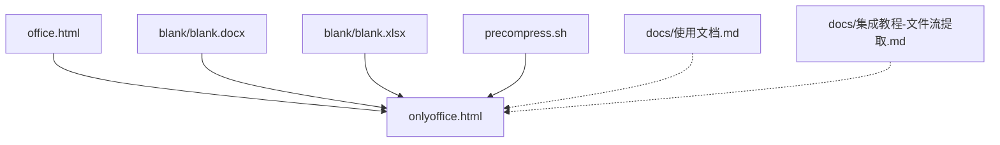

# fernfei/OnlyofficePersonal

> ONLYOFFICE offline in the browser: edit Word, Excel, PPT and PDF with no server, files kept local.

## The problem
Editing office documents without sending files to a server usually means deploying a Document Server.

## What it actually does
The repository ships the compiled ONLYOFFICE 9.3 products with `x2t.wasm` (updated in 9.4), which converts documents in the browser. It edits docx, xlsx, pptx, ODF, CSV and PDF (annotations, forms). `office.html` serves as a demo; `onlyoffice.html` is embedded through an iframe and `postMessage` to inject and retrieve files.

## How it is wired


## Trying it
```bash
python -m http.server 8000
npx http-server -p 8000
php -S localhost:8000
```

## Cost and gotchas
Free. A static server is enough; `x2t.wasm` weighs 40 MB (6.6 MB with precompression and strong caching). AGPL-3.0 license, ONLYOFFICE components subject to their own rights. The README is in Chinese.

## What it is not
It is not the official ONLYOFFICE: it is a third-party packaging, with no save callback (the file stream is extracted another way).

## Alternatives
No alternative named in the README.

## For you
Worth watching if you need to edit documents offline in a web app; its AGPL license is a burden for commercial use.
