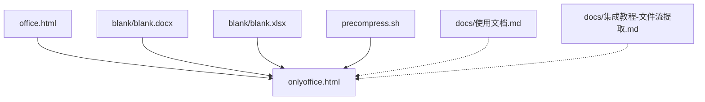

# fernfei/OnlyofficePersonal

> ONLYOFFICE hors ligne dans le navigateur : édition de Word, Excel, PPT et PDF sans serveur, fichiers gardés en local.

## Le problème
Éditer des documents bureautiques sans envoyer de fichiers à un serveur oblige d'ordinaire à déployer un Document Server.

## Ce que ça fait vraiment
Le dépôt livre les produits compilés d'ONLYOFFICE 9.3 avec `x2t.wasm` (mis à jour en 9.4) qui convertit les documents dans le navigateur. Il édite docx, xlsx, pptx, ODF, CSV et PDF (annotations, formulaires). `office.html` sert de démonstration ; `onlyoffice.html` s'intègre par iframe et `postMessage` pour injecter et récupérer des fichiers.

## Comment c'est branché


## Essayer
```bash
python -m http.server 8000
npx http-server -p 8000
php -S localhost:8000
```

## Coût et pièges
Gratuit. Un serveur statique suffit ; `x2t.wasm` pèse 40 Mo (6,6 Mo avec précompression et cache fort). Licence AGPL-3.0, composants ONLYOFFICE soumis à leurs droits. Le README est en chinois.

## Ce que ce n'est pas
Ce n'est pas l'ONLYOFFICE officiel : c'est un empaquetage tiers, sans callback de sauvegarde (le flux de fichier est extrait autrement).

## Alternatives
Aucune alternative nommée dans le README.

## Pour toi
À surveiller si tu dois éditer des documents hors ligne dans une appli web ; sa licence AGPL pèse pour un usage commercial.

