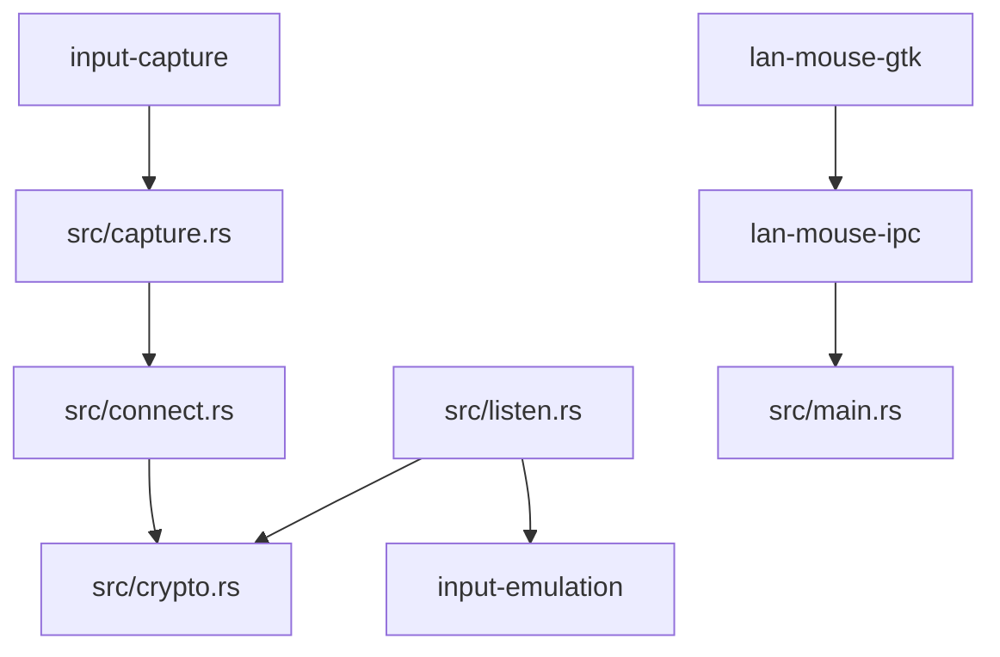

# feschber/lan-mouse

> Shares mouse and keyboard between several computers on the local network, a free alternative to Synergy.

## The problem
Using several machines with a single set of peripherals without buying a hardware KVM switch.

## What it actually does
Lan Mouse captures input events on one machine and sends them, DTLS-encrypted, to another that replays them. The GTK interface or the command line declares the machines and their position (left, right, top, bottom). A daemon mode and a systemd service allow running it continuously. The encryption has no defense against timing side-channel attacks, according to the README.

## How it is wired


## Trying it
```bash
cargo build --release
cargo install lan-mouse
lan-mouse daemon
lan-mouse cli help
```

## Cost and gotchas
Free. Open UDP port 4242 in the firewall and authorize each machine by certificate fingerprint. Noted limits: X11 only works on the receiving side, Sway or wlroots lose modifiers without libei, invisible cursor on Windows without a real mouse, accessibility permission on macOS. GPL-3.0 license.

## What it is not
It is not clipboard or screen sharing: it only relays mouse and keyboard. Android and iOS support is only an external proof of concept.

## Alternatives
Synergy 2/3, ShareMouse, Deskflow and Input Leap are cited: choose them if you want more established tools or sharing beyond inputs.

## For you
Watch: handy for a multi-machine desk (GPU workstation plus laptop), no stake for your pipelines.
