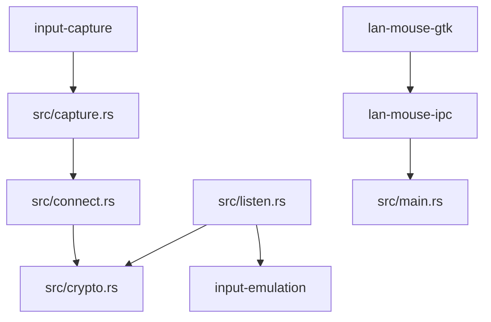

# feschber/lan-mouse

> Partage souris et clavier entre plusieurs ordinateurs sur le réseau local, alternative libre à Synergy.

## Le problème
Utiliser plusieurs machines avec un seul jeu de périphériques sans acheter un commutateur KVM matériel.

## Ce que ça fait vraiment
Lan Mouse capture les événements d'entrée sur une machine et les envoie, chiffrés en DTLS, à une autre qui les rejoue. L'interface GTK ou la ligne de commande déclare les machines et leur position (gauche, droite, haut, bas). Un mode daemon et un service systemd permettent de le lancer en continu. Le chiffrement n'a pas de parade contre les attaques par canal temporel, selon le README.

## Comment c'est branché


## Essayer
```bash
cargo build --release
cargo install lan-mouse
lan-mouse daemon
lan-mouse cli help
```

## Coût et pièges
Gratuit. Ouvrir le port UDP 4242 au pare-feu et autoriser chaque machine par empreinte de certificat. Limites notées : X11 ne sert que côté réception, Sway ou wlroots perdent les modificateurs sans libei, curseur invisible sous Windows sans vraie souris, autorisation d'accessibilité sur macOS. Licence GPL-3.0.

## Ce que ce n'est pas
Ce n'est pas un partage de presse-papier ni d'écran : il relaie seulement souris et clavier. Le support Android et iOS n'est qu'une preuve de concept externe.

## Alternatives
Synergy 2/3, ShareMouse, Deskflow et Input Leap sont cités : choisis-les si tu veux des outils plus établis ou le partage au-delà des entrées.

## Pour toi
À surveiller : pratique pour un bureau multi-machines (station GPU plus portable), sans enjeu pour tes pipelines.

