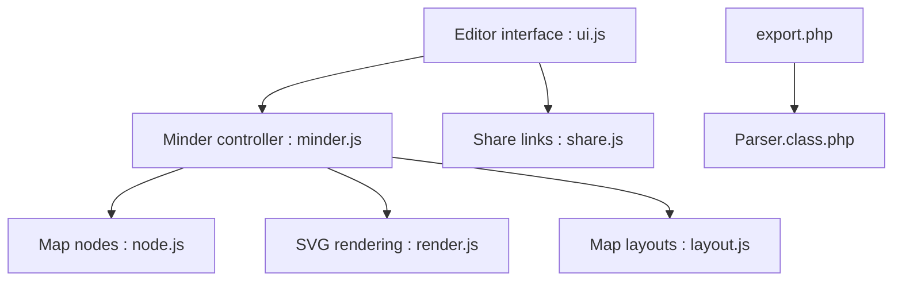

# fex-team/kityminder

> Online SVG-based mind map editor from Baidu's FEX team.

## The problem
Editing mind maps in the browser with an experience close to a native tool.

## What it actually does
SVG web application: node editing, layouts, connectors, import/export (MindManager, XMind via a PHP export), link sharing and cloud sync through Baidu's online service. The README advises against starting from this repository for development.

## How it is wired


## Trying it
```bash
git clone https://github.com/fex-team/kityminder.git
git submodule init && git submodule update
npm install
bower install
grunt
```

## Cost and gotchas
Free. Old build chain (bower, grunt, submodules). Last push in 2019. Cloud and sharing rely on naotu.baidu.com.

## What it is not
Not the recommended building block: the README points to kityminder-core (visualization) and kityminder-editor (editing).

## Alternatives
- kityminder-core: for visualizing maps.
- kityminder-editor: for embedded editing.

## For you
Ignore: repository inactive since 2019, whose author himself redirects to other modules.
