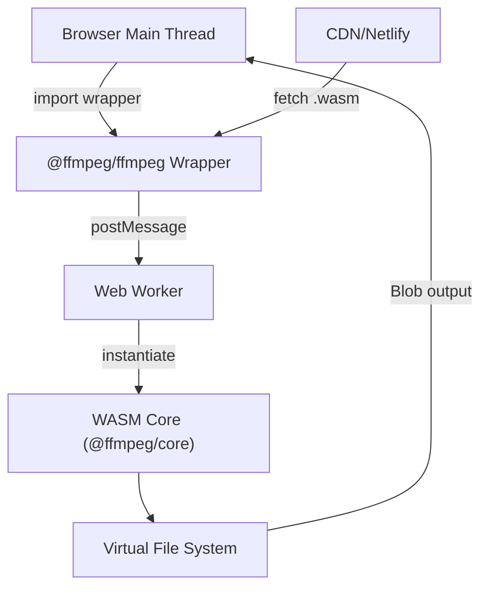

# ffmpegwasm/ffmpeg.wasm

> FFmpeg port to WebAssembly/JavaScript to convert audio and video directly in the browser.

## The problem
Transcoding audio or video forces you to upload files to a server or install FFmpeg locally.

## What it actually does
FFmpeg's C code is compiled to WebAssembly with Emscripten. A JS wrapper runs the core in a Web Worker, with an in-memory virtual file system; outputs come back as blobs. The .wasm core is downloaded at runtime (CDN). Separate packages exist: core, core-mt (multithreaded), util, types.

## How it is wired


## Trying it
```bash
# Le README fourni ne contient aucune commande ; il renvoie à la page Getting Started
# https://ffmpegwasm.netlify.app/docs/getting-started/installation
```

## Cost and gotchas
Free. The .wasm file is loaded from a CDN at runtime. The README is very short: the details are in the external documentation.

## What it is not
Not a native FFmpeg: it runs in the browser, through the worker. The README gives no performance figures.

## Alternatives
No alternative named in the README.

## For you
Worth watching: useful to preprocess media client-side in a demo or an AI app, but outside the data/MLOps core.
