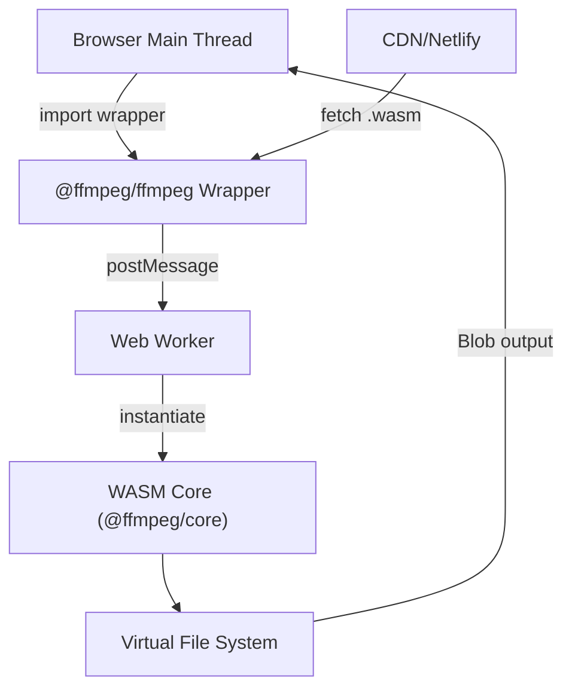

# ffmpegwasm/ffmpeg.wasm

> Port FFmpeg en WebAssembly/JavaScript pour convertir audio et vidéo directement dans le navigateur.

## Le problème
Transcoder de l'audio ou de la vidéo oblige à envoyer les fichiers à un serveur ou à installer FFmpeg en local.

## Ce que ça fait vraiment
Le code FFmpeg C est compilé en WebAssembly par Emscripten. Un wrapper JS lance le noyau dans un Web Worker, avec un système de fichiers virtuel en mémoire ; les sorties reviennent en blobs. Le noyau .wasm est téléchargé à l'exécution (CDN). Des paquets séparés existent : core, core-mt (multithread), util, types.

## Comment c'est branché


## Essayer
```bash
# Le README fourni ne contient aucune commande ; il renvoie à la page Getting Started
# https://ffmpegwasm.netlify.app/docs/getting-started/installation
```

## Coût et pièges
Gratuit. Le fichier .wasm est chargé depuis un CDN à l'exécution. Le README est très court : le détail est dans la documentation externe.

## Ce que ce n'est pas
Pas un FFmpeg natif : il tourne dans le navigateur, via le worker. Le README ne chiffre pas les performances.

## Alternatives
Aucune alternative nommée dans le README.

## Pour toi
Surveiller : utile pour prétraiter médias côté client dans une démo ou une app IA, mais hors du cœur data/MLOps.

