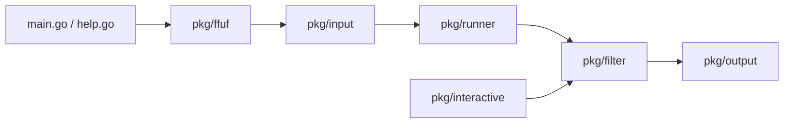

# ffuf/ffuf

> Go command-line tool that tests web URLs, headers or parameters in bulk from word lists.

## The problem
Checking which resources, virtual hosts or parameters a web server accepts requires sending a large number of varied requests and sorting the responses.

## What it actually does
The `FUZZ` keyword, placed in the URL, headers or body of a request, is replaced by each entry of a word list. Responses are kept or discarded according to criteria (HTTP code, size, lines, words, regexp, time). The program runs 40 threads in parallel by default, auto-calibrates filters, accepts an external mutator and offers an interactive mode to reconfigure filters while running. Outputs: JSON, HTML, CSV, Markdown.

## How it is wired


## Trying it
```bash
go install github.com/ffuf/ffuf/v2@latest
ffuf -w /path/to/wordlist -u https://target/FUZZ -maxtime 60
```

## Cost and gotchas
Free, MIT. Precompiled binaries, Scoop, Winget, Homebrew or Go 1.20+. The default throughput (40 threads) can heavily load a target: `-rate` and `-p` allow limiting it. A local build shows the commit and not the tag; only binaries from the releases page are authoritative.

## What it is not
It is not a tool to run against services you are not authorized to test: the request volume is comparable to an attack. The README presents a legal exercise: ffufme (local container) and ffuf.me. It is not a load-testing tool nor a vulnerability scanner.

## Alternatives
- Radamsa: pluggable external mutator, not a competitor.

## For you
Ignore: web penetration testing tool unrelated to a data/AI workflow, to keep only if you yourself audit web applications you are in charge of.
