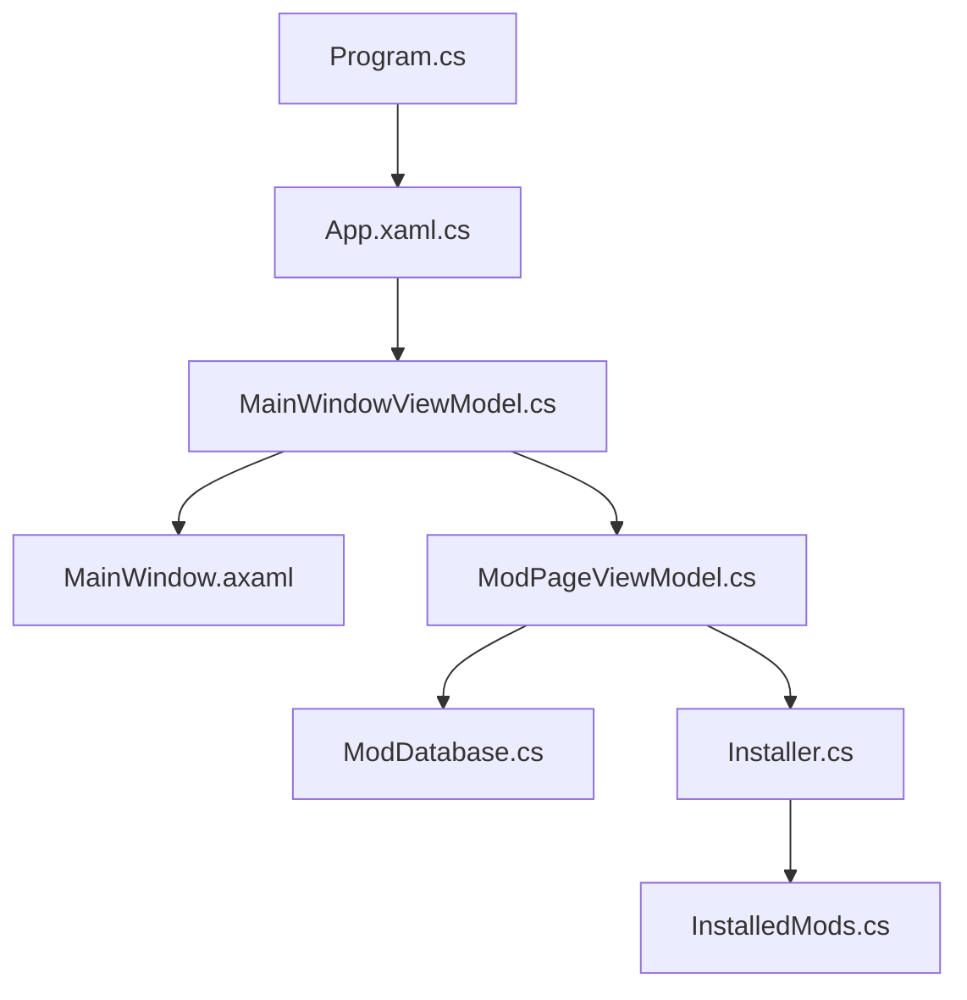

# fifty-six/Scarab

> Mod manager for Hollow Knight that makes installing mods easier.

## The problem
Installing Hollow Knight mods by hand is tedious.

## What it actually does
An Avalonia application that displays the mod catalog (`ModDatabase.cs`), downloads and installs them (`Installer.cs`) while remembering the state (`InstalledMods.cs`). The mods then appear at the top left of the game's title screen.

## How it is wired

## Trying it
No command: download the latest release, unzip it and run it.

## Cost and gotchas
Free. Owning the game is required. Last push in March 2026.

## What it is not
Not a general mod tool: specific to Hollow Knight.

## Alternatives
No alternative named in the README.

## For you
Ignore: a video game utility, unrelated to data, AI or MLOps work.
