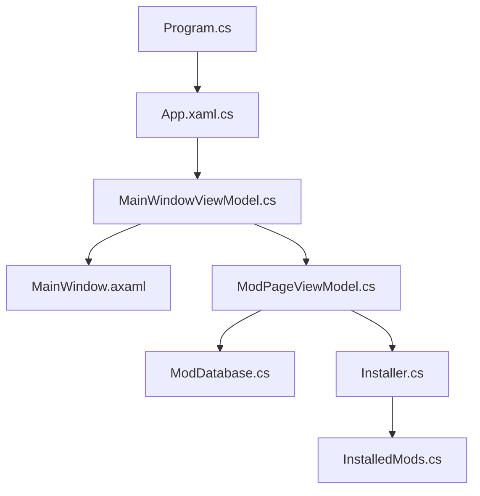

# fifty-six/Scarab

> Gestionnaire de mods pour Hollow Knight qui facilite leur installation.

## Le problème
Installer des mods de Hollow Knight à la main est fastidieux.

## Ce que ça fait vraiment
Une application Avalonia qui affiche le catalogue des mods (`ModDatabase.cs`), les télécharge et les installe (`Installer.cs`) en mémorisant l'état (`InstalledMods.cs`). Les mods apparaissent ensuite en haut à gauche de l'écran-titre du jeu.

## Comment c'est branché

## Essayer
Aucune commande : télécharger la dernière version, la décompresser et la lancer.

## Coût et pièges
Gratuit. Possession du jeu requise. Dernier push en mars 2026.

## Ce que ce n'est pas
Pas un outil général de mods : spécifique à Hollow Knight.

## Alternatives
Aucune alternative nommée dans le README.

## Pour toi
Ignorer : un utilitaire de jeu vidéo, sans lien avec un travail data, IA ou MLOps.

