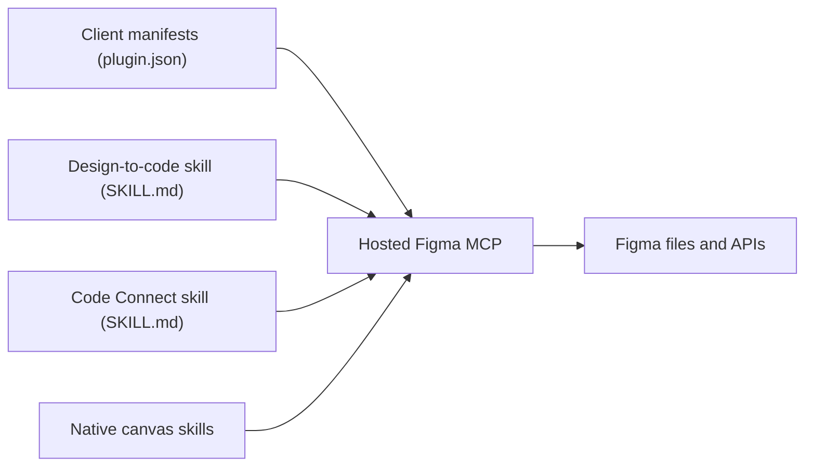

# figma/mcp-server-guide

> Guide and skills to connect Figma's hosted MCP server to a coding agent.

## The problem
A coding agent cannot see Figma designs: it guesses components, tokens and layout.

## What it actually does
This repository contains no server: it is documentation, plugin manifests (Claude, Cursor, GitHub, Gemini) and Markdown skills pointing to `https://mcp.figma.com/mcp`. Tools cited: `get_design_context` (React + Tailwind), `get_variable_defs`, `get_screenshot`, `get_metadata`. Skills: design to code, Code Connect, writing to the canvas, FigJam.

## How it is wired


## Trying it
```bash
claude plugin install figma@claude-plugins-official
claude mcp add --transport http figma https://mcp.figma.com/mcp
gemini extensions install https://github.com/figma/mcp-server-guide
```

## Cost and gotchas
Figma account required. Limits: 6 calls per month on the Starter plan or View/Collab seats; per-minute limits for Dev/Full seats. Writing to the canvas is free in beta, then pay-as-you-go.

## What it is not
It is not the MCP server itself nor a reusable open source project: no license is declared. The `skills-figquery/` folder largely duplicates `skills/`.

## Alternatives
No alternative named in the README.

## For you
Adopt only if your team uses Figma: it is the official route, but of no interest for a data profile outside design.
