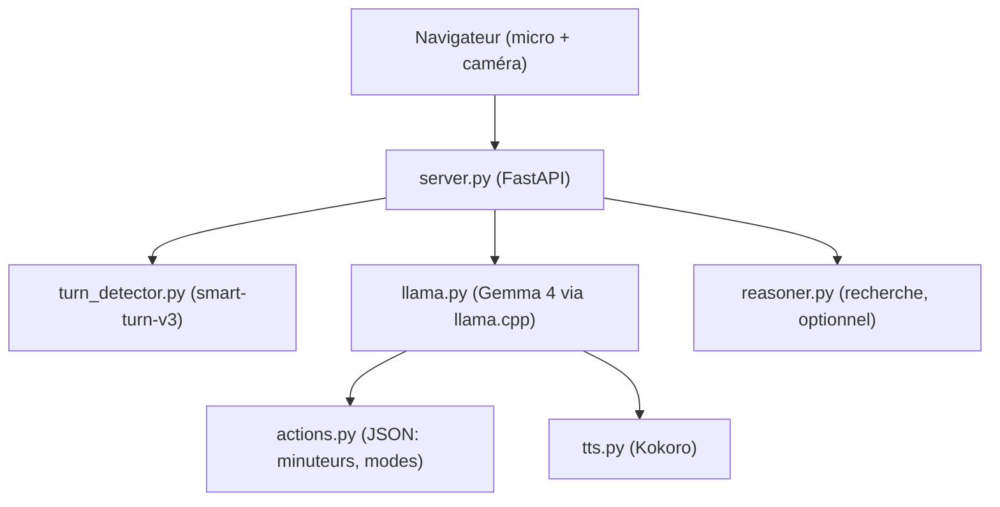

# fikrikarim/parlor

> Real-time voice and vision assistant that runs entirely locally, on an Apple Silicon Mac or Linux.

## The problem
State-of-the-art voice assistants are hosted and closed. Parlor aims to offer a voice conversation with a camera without anything leaving the machine.

## What it actually does
The browser sends microphone and camera to a FastAPI server. smart-turn-v3 judges the end of a turn, Gemma 4 E4B via llama.cpp listens and watches, then Kokoro TTS answers sentence by sentence. It handles interruption by voice, timers, a translation mode and a silent listening mode. Web search is optional, through a remote model.

## How it is wired


## Trying it
```bash
git clone https://github.com/fikrikarim/parlor.git
cd parlor
uv sync
uv run parlor
```

## Cost and gotchas
Python 3.12 or later, recent llama.cpp (build b9503 minimum), about 6 GB of free RAM and an Apple Silicon Mac or a compatible Linux GPU. Models are downloaded on first launch (about 5.7 GB). Background search stays disabled without `REASONER_API_KEY`.

## What it is not
It is not a full-duplex model: the README adopts a classic cascade after a fine-tuning attempt failed. It is presented as a research preview, and the text under "AI disclosure" is AI-generated.

## Alternatives
No alternative named in the README.

## For you
Worth watching: a concrete reference for a local voice assistant with latency measurements, but experimental and memory-hungry.
