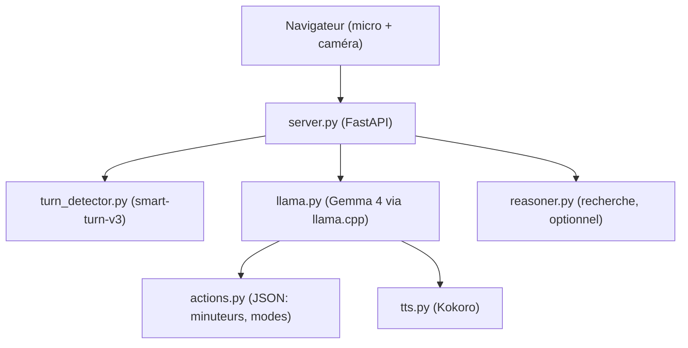

# fikrikarim/parlor

> Assistant vocal et visuel en temps réel qui tourne entièrement en local, sur Mac Apple Silicon ou Linux.

## Le problème
Les assistants vocaux de pointe sont hébergés et fermés. Parlor cherche à offrir une conversation vocale avec caméra sans que rien ne quitte la machine.

## Ce que ça fait vraiment
Le navigateur envoie micro et caméra à un serveur FastAPI. smart-turn-v3 juge la fin de tour, Gemma 4 E4B via llama.cpp écoute et regarde, puis Kokoro TTS répond phrase par phrase. Il gère l'interruption par la voix, les minuteurs, un mode traduction et un mode écoute silencieuse. La recherche web est optionnelle, par un modèle distant.

## Comment c'est branché


## Essayer
```bash
git clone https://github.com/fikrikarim/parlor.git
cd parlor
uv sync
uv run parlor
```

## Coût et pièges
Python 3.12 ou plus, llama.cpp récent (build b9503 minimum), environ 6 Go de RAM libres et un Mac Apple Silicon ou un GPU Linux compatible. Les modèles se téléchargent au premier lancement (environ 5,7 Go). La recherche en arrière-plan reste désactivée sans `REASONER_API_KEY`.

## Ce que ce n'est pas
Ce n'est pas un modèle full-duplex : le README adopte une cascade classique après l'échec d'un fine-tuning. Il est présenté comme un aperçu de recherche, et le texte sous « AI disclosure » est généré par IA.

## Alternatives
Aucune alternative nommée dans le README.

## Pour toi
À surveiller : une référence concrète pour un assistant vocal local avec mesures de latence, mais expérimental et gourmand en mémoire.

