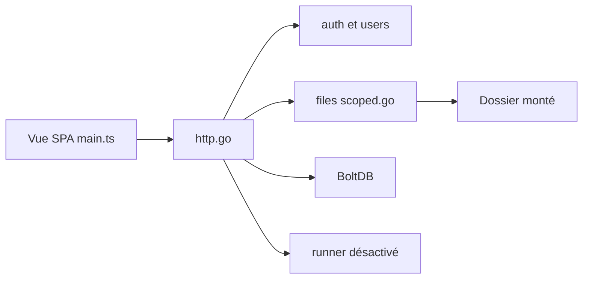

# filebrowser/filebrowser

> Self-hosted web interface to browse, upload and edit the files of a server folder — now archived.

## The problem
Giving access to a server folder from a browser without setting up a full cloud.

## What it actually does
A Go server exposes the chosen folder through an HTTP API (list, upload, preview, search, share). A Vue/TypeScript application serves as the interface. Users, permissions and path rules are handled on the Go side, with BoltDB storage. Resumable uploads go through TUS, with an in-memory or optional Redis cache. A command runner exists, disabled by default.

## How it is wired


## Trying it
```bash
# Le README renvoie à la documentation (dossier docs) sans commande d'installation.
# Seule commande citée, pour réactiver l'exécuteur (déconseillé) :
# --disable-exec=false
```

## Cost and gotchas
Free, but archived on 2026-09-01: no more fixes or security updates. JWT sessions cannot be revoked and the command runner is equivalent to a shell. Do not expose it directly to the Internet.

## What it is not
It is no longer maintained software: two families of known flaws will remain open. It is not a full collaborative cloud.

## Alternatives
No alternative named in the README.

## For you
Ignore for anything new: without security fixes, deploying web access to data files is an unnecessary risk.
