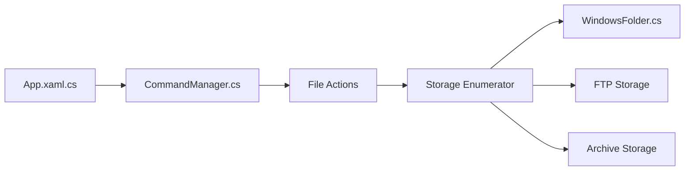

# files-community/Files

> Modern file management software for Windows, featuring tabs, labels, and integrations.

## The problem
The basic Windows Explorer is limited when it comes to organizing files for multitasking.

## What it actually does
Navigation, file searching, and operations with multitasking (tabs, windows), labels, archives, FTP, previews, Git, and open/save dialogs. Storage providers (Windows, FTP, archives) are abstracted behind a command manager. Short README: The key lies in the architecture.

## How it is wired

## Trying it
No documented installation: installation via the Microsoft Store or the traditional installer (links not reproduced).

## Cost and gotchas
Free through the installer; recommended purchase from the Microsoft Store to support the project. Windows only.

## What it is not
Not cross-platform. The README does not detail the functions or limitations.

## Alternatives
No alternative is specified in the README file.

## For you
Please disregard: Windows file manager, unrelated to data/AI.
