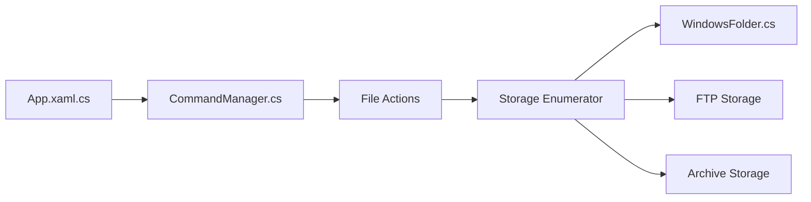

# files-community/Files

> Gestionnaire de fichiers moderne pour Windows avec onglets, étiquettes et intégrations.

## Le problème
L'explorateur Windows de base est limité pour l'organisation multitâche des fichiers.

## Ce que ça fait vraiment
Navigation, recherche et opérations sur les fichiers avec multitâche (onglets, fenêtres), étiquettes, archives, FTP, aperçus, Git, boîtes de dialogue ouvrir/enregistrer. Les fournisseurs de stockage (Windows, FTP, archives) sont abstraits derrière un gestionnaire de commandes. README court : l'essentiel vient de l'architecture.

## Comment c'est branché

## Essayer
Aucune commande documentée : installation par le Microsoft Store ou l'installateur classique (liens non reproduits).

## Coût et pièges
Gratuit via l'installateur ; achat conseillé dans le Microsoft Store pour soutenir le projet. Windows uniquement.

## Ce que ce n'est pas
Pas multiplateforme. Le README ne détaille ni fonctions ni limites.

## Alternatives
Aucune alternative nommée dans le README.

## Pour toi
À ignorer : gestionnaire de fichiers Windows sans lien avec la data/IA.

