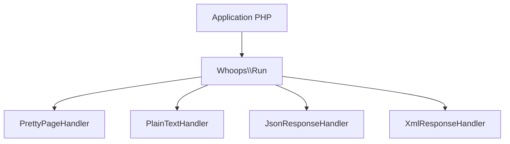

# filp/whoops

> PHP error handling library built on a stack of handlers, with a readable error page, for PHP web developers.

## The problem
Raw PHP errors are hard to read and debug in a web application.

## What it actually does
Stacks error and exception handlers. Provides a detailed error page (PrettyPageHandler), text output for the CLI, and JSON or XML responses for AJAX calls. Can open the cited files in the editor. No mandatory dependency.

## How it is wired
Simplified diagram based on the sheet, no diagram supplied.



## Trying it
```bash
composer require filp/whoops
```
```php
$whoops = new \Whoops\Run;
$whoops->pushHandler(new \Whoops\Handler\PrettyPageHandler);
$whoops->register();
```

## Cost and gotchas
Free. Requires Composer and a PHP project. Already included in Laravel and Mezzio according to the README.

## What it is not
It is not a monitoring or production error reporting tool: it displays errors. Nothing in the README about hiding errors in production.

## Alternatives
No alternative named in the README.

## For you
Of no interest for a data/AI/MLOps profile: it is web PHP, ignore unless you maintain a PHP app.
