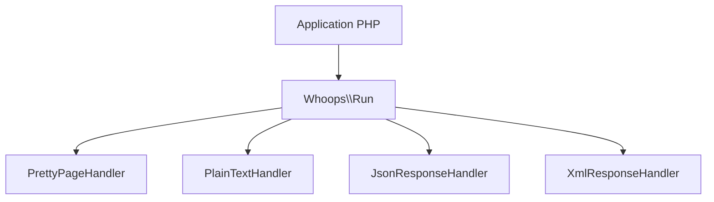

# filp/whoops

> Bibliothèque PHP de gestion d'erreurs en pile, avec une page d'erreur lisible, pour développeurs web PHP.

## Le problème
Les erreurs PHP brutes sont difficiles à lire et à déboguer dans une application web.

## Ce que ça fait vraiment
Empile des gestionnaires d'erreurs et d'exceptions. Fournit une page d'erreur détaillée (PrettyPageHandler), une sortie texte pour la CLI, et des réponses JSON ou XML pour les appels AJAX. Peut ouvrir les fichiers cités dans l'éditeur. Aucune dépendance obligatoire.

## Comment c'est branché
Schéma simplifié d'après la fiche, sans diagramme fourni.



## Essayer
```bash
composer require filp/whoops
```
```php
$whoops = new \Whoops\Run;
$whoops->pushHandler(new \Whoops\Handler\PrettyPageHandler);
$whoops->register();
```

## Coût et pièges
Gratuit. Demande Composer et un projet PHP. Déjà inclus dans Laravel et Mezzio selon le README.

## Ce que ce n'est pas
Ce n'est pas un outil de supervision ni de remontée d'erreurs en production : il affiche les erreurs. Rien sur le masquage en production dans le README.

## Alternatives
Aucune alternative nommée dans le README.

## Pour toi
Sans intérêt pour un profil data/IA/MLOps : c'est du PHP web, à ignorer sauf si tu maintiens une appli PHP.

