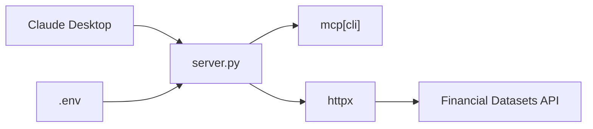

# financial-datasets/mcp-server

> MCP server giving Claude access to Financial Datasets' financial statements, prices and news.

## The problem
An AI assistant has no reliable, structured source for financial statements, stock prices or crypto prices.

## What it actually does
A small Python server (`server.py`) exposing ten tools: income statement, balance sheet, cash flow statement, current and historical stock prices, company news, tickers and crypto prices. Each tool calls the Financial Datasets API through `httpx`, with the key read from `.env`. No visible database or cache.

## How it is wired


## Trying it
```bash
git clone https://github.com/financial-datasets/mcp-server
cd mcp-server
uv venv
source .venv/bin/activate
uv add "mcp[cli]" httpx
cp .env.example .env
uv run server.py
```

## Cost and gotchas
Requires `FINANCIAL_DATASETS_API_KEY`; the README does not state pricing. Python 3.10+ and uv are required. Claude Desktop configuration uses absolute paths.

## What it is not
Not a data source: it is an adapter to a paid or quota-limited third-party service. No advice or analysis.

## Alternatives
- No alternative named in the README.

## For you
Keep an eye on it: handy for prototyping a financial agent, but it depends on a SaaS and has had no update since 2025-06.
