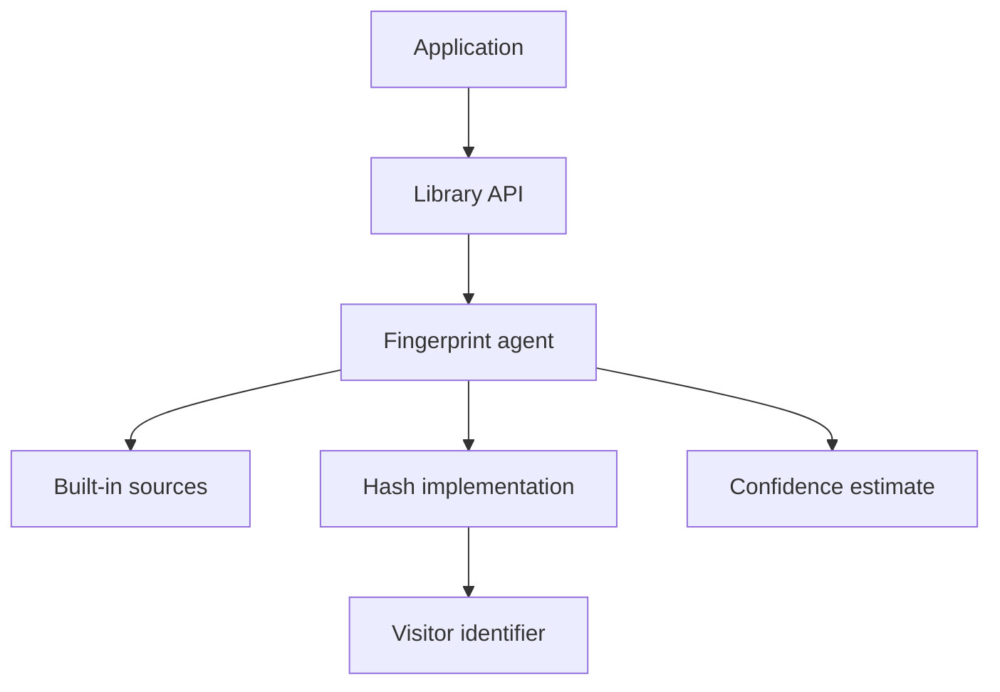

# fingerprintjs/fingerprintjs

> Browser library that computes a visitor identifier by fingerprinting, stable even in private browsing.

## The problem
Cookies disappear in private browsing; you need another way to recognize a visitor.

## What it actually does
Collects browser signals (canvas, WebGL, audio, fonts, screen, content blockers), hashes them into a `visitorId` identifier and provides a confidence estimate. Everything happens client-side.

## How it is wired


## Trying it
```bash
npm install @fingerprintjs/fingerprintjs
```
```jsx
const fp = await FingerprintJS.load();
const result = await fp.get();
console.log(result.visitorId)
```

## Cost and gotchas
Free (MIT). Accuracy is markedly lower than the commercial version, and the fingerprint can be forged. Importing via CDN fails with some blockers or browsers.

## What it is not
It is not reliable anti-fraud: the README says that fingerprints generated in the browser are exposed to spoofing. The accurate version is a closed commercial product.

## Alternatives
Fingerprint Identification (commercial, closed), with server-side processing for greater accuracy.

## For you
Ignore: outside your data and AI scope, limited accuracy, and tracking users calls for vigilance on privacy.
