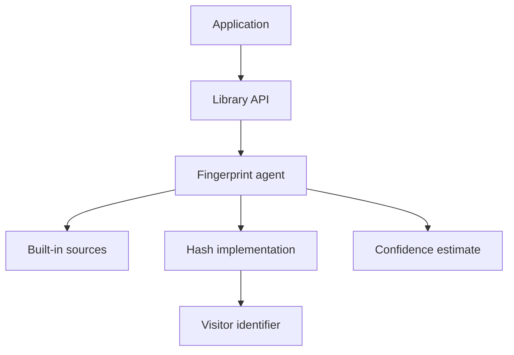

# fingerprintjs/fingerprintjs

> Bibliothèque navigateur qui calcule un identifiant de visiteur par empreinte, stable même en navigation privée.

## Le problème
Les cookies disparaissent en navigation privée ; il faut reconnaître un visiteur autrement.

## Ce que ça fait vraiment
Collecte des signaux du navigateur (canvas, WebGL, audio, polices, écran, bloqueurs de contenu), les hache en identifiant `visitorId` et fournit une estimation de confiance. Tout se passe côté client.

## Comment c'est branché


## Essayer
```bash
npm install @fingerprintjs/fingerprintjs
```
```jsx
const fp = await FingerprintJS.load();
const result = await fp.get();
console.log(result.visitorId)
```

## Coût et pièges
Gratuit (MIT). Précision nettement plus faible que la version commerciale, empreinte falsifiable. L'import via CDN échoue avec certains bloqueurs ou navigateurs.

## Ce que ce n'est pas
Ce n'est pas de l'anti-fraude fiable : le README dit que les empreintes générées côté navigateur sont exposées à l'usurpation. La version précise est un produit commercial fermé.

## Alternatives
Fingerprint Identification (commercial, fermé), traitement côté serveur pour plus de précision.

## Pour toi
À ignorer : hors de ton périmètre data et IA, précision limitée, et le pistage d'utilisateurs demande une vigilance sur la vie privée.

