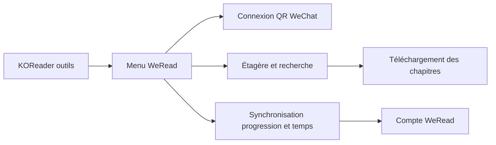

# finlater/weread.koplugin

> KOReader plugin for reading WeRead books on Kindle or Kobo e-readers, with sync.

## The problem
Closed e-readers do not support WeRead; you cannot read your WeRead books in KOReader.

## What it actually does
WeChat QR code login, bookshelf, search, download of chapters or the whole book, sync of progress, reading time and statistics, viewing of notes, highlights and reviews. SimpleUI and Zen_UI integration. Does not push local annotations to WeRead. A closed, more complete version is offered by the author.

## How it is wired


## Trying it
```bash
koreader/plugins/weread.koplugin/
```
Copy the plugin folder into `plugins`, restart KOReader, then open Tools → 微信读书.

## Cost and gotchas
Free. A personal WeRead API key must be generated (Skill); the README warns of a risk of account blocking. KOReader 2026.03 or newer recommended.

## What it is not
Not an official or complete client: no comments or likes; personal and research use only.

## Alternatives
The closed WeReader, by the same author (more complete); kindlebtcontroller.koplugin and one.koplugin are recommended for other uses.

## For you
Ignore: useful only if you read WeRead on an e-reader; nothing for data or AI.
