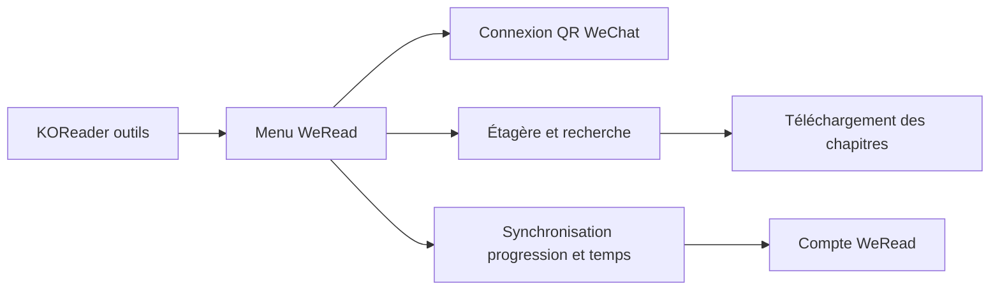

# finlater/weread.koplugin

> Greffon KOReader pour lire des livres WeRead sur liseuses Kindle ou Kobo, avec synchronisation.

## Le problème
Les liseuses fermées ne gèrent pas WeRead ; on ne lit pas ses livres WeRead dans KOReader.

## Ce que ça fait vraiment
Connexion par QR code WeChat, étagère, recherche, téléchargement de chapitres ou du livre, synchronisation de la progression, du temps de lecture et des statistiques, consultation des notes, surlignages et critiques. Intégration SimpleUI et Zen_UI. N'envoie pas les annotations locales vers WeRead. Une version fermée, plus complète, est proposée par l'auteur.

## Comment c'est branché


## Essayer
```bash
koreader/plugins/weread.koplugin/
```
Copier le dossier du greffon dans `plugins`, redémarrer KOReader, puis ouvrir Outils → 微信读书.

## Coût et pièges
Gratuit. Clé d'API personnelle WeRead à générer (Skill) ; risque de blocage de compte signalé par l'avertissement du README. KOReader 2026.03 ou plus récent conseillé.

## Ce que ce n'est pas
Pas un client officiel ni complet : pas de commentaires ni de likes ; usage personnel et de recherche seulement.

## Alternatives
WeReader fermé, du même auteur (plus complet) ; kindlebtcontroller.koplugin et one.koplugin sont recommandés pour d'autres usages.

## Pour toi
À ignorer : utile uniquement si tu lis WeRead sur liseuse ; rien pour la data ou l'IA.

