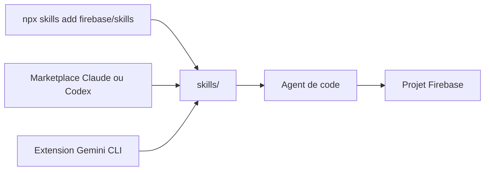

# firebase/agent-skills

> Official agent skills to help coding agents work with Firebase.

## The problem
An agent knows the current state of Firebase APIs and best practices poorly and produces approximate code.

## What it actually does
A package of skills in the Agent Skills format, installable through the `skills` CLI, as a Gemini CLI extension, Claude plugin, Codex plugin, Kimi plugin, or by manual copy (Cursor, Windsurf, Copilot). The README does not list the skills: undocumented. A symbolic link allows local development.

## How it is wired


## Trying it
```bash
npx skills add firebase/skills
gemini extensions install https://github.com/firebase/skills
claude plugin marketplace add firebase/skills
claude plugin install firebase@firebase
codex plugin marketplace add firebase/skills
codex plugin add firebase@firebase
```

## Cost and gotchas
Free; a Firebase account is useful for any real use, and its services remain billed according to your plan. The repository name (`agent-skills`) differs from the one in the commands (`firebase/skills`).

## What it is not
Not a library or an SDK: these are instructions for the agent. The exact content of the skills is not described in the README.

## Alternatives
No alternative named in the README.

## For you
Worth watching: useful if your back end or demos run on Firebase; otherwise irrelevant for a data/AI profile.
