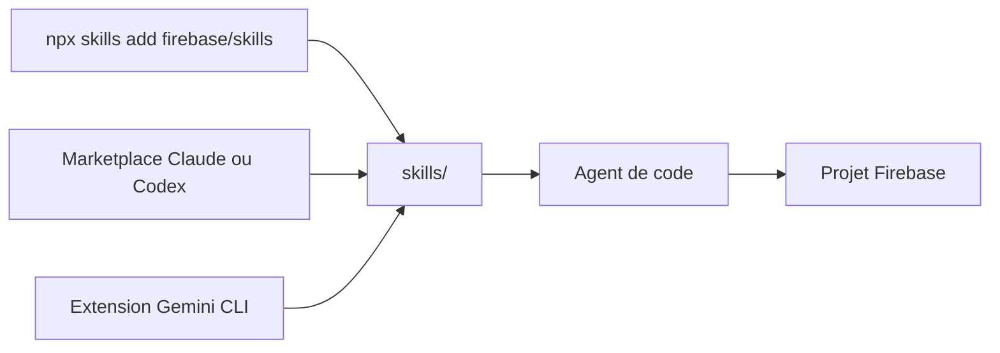

# firebase/agent-skills

> Skills d'agents officiels pour aider les agents de code à travailler avec Firebase.

## Le problème
Un agent connaît mal l'état actuel des API et des bonnes pratiques de Firebase et produit du code approximatif.

## Ce que ça fait vraiment
Un paquet de skills au format Agent Skills, installable par le CLI `skills`, comme extension Gemini CLI, plugin Claude, plugin Codex, plugin Kimi, ou par copie manuelle (Cursor, Windsurf, Copilot). Le README ne liste pas les skills : non documenté. Un lien symbolique permet de développer en local.

## Comment c'est branché


## Essayer
```bash
npx skills add firebase/skills
gemini extensions install https://github.com/firebase/skills
claude plugin marketplace add firebase/skills
claude plugin install firebase@firebase
codex plugin marketplace add firebase/skills
codex plugin add firebase@firebase
```

## Coût et pièges
Gratuit ; un compte Firebase est utile pour tout usage réel, ses services restent facturés selon ton plan. Le nom du dépôt (`agent-skills`) diffère de celui des commandes (`firebase/skills`).

## Ce que ce n'est pas
Pas une bibliothèque ni un SDK : ce sont des instructions pour l'agent. Le contenu exact des skills n'est pas décrit dans le README.

## Alternatives
Aucune alternative nommée dans le README.

## Pour toi
À surveiller : utile si ton back-end ou tes démos tournent sur Firebase ; sinon sans objet pour un profil data/IA.

