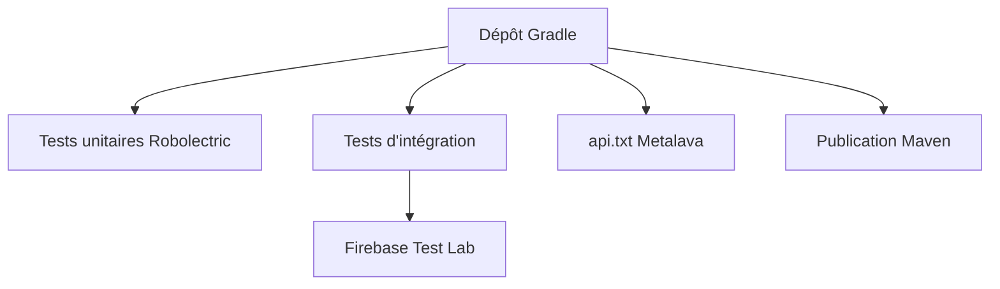

# firebase/firebase-android-sdk

> Source code of the Firebase Android SDKs, except Analytics and Auth, for those who contribute or build.

## The problem
Many Firebase Android SDKs have to be built, tested and published consistently.

## What it actually does
The README is mostly about developing the repository itself: JDK 17, Android Studio, submodules, NDK 27 for Crashlytics. Robolectric unit tests, integration tests on an emulator or Firebase Test Lab (`google-services.json` file). Public API tracked by Metalava, `@Keep` and `@KeepForSdk` annotations, Spotless formatting, local Maven publishing.

## How it is wired
Simplified diagram based on the sheet, no diagram provided.



## Trying it
```bash
git clone --recurse-submodules git@github.com:firebase/firebase-android-sdk.git
./gradlew :<firebase-project>:check
./gradlew :<firebase-project>:connectedCheck
./gradlew :<firebase-project>:spotlessApply
```

## Cost and gotchas
Free to build. Integration tests need a Firebase project and, on Test Lab, a gcloud project with billing. 425 open issues.

## What it is not
Not a guide to using Firebase in an app: it is the contributor's guide. Analytics and Auth are not included.

## Alternatives
No alternative named in the README.

## For you
Ignore: documentation for contributing to an Android SDK, of no direct interest for a data/AI/MLOps profile.
