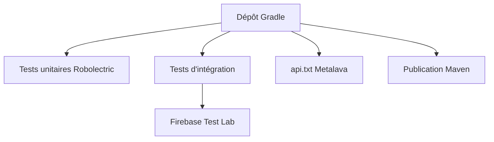

# firebase/firebase-android-sdk

> Code source des SDK Android de Firebase, sauf Analytics et Auth, pour qui contribue ou compile.

## Le problème
Il faut compiler, tester et publier de nombreux SDK Android Firebase de façon cohérente.

## Ce que ça fait vraiment
Le README décrit surtout le développement du dépôt : JDK 17, Android Studio, sous-modules, NDK 27 pour Crashlytics. Tests unitaires Robolectric, tests d'intégration sur émulateur ou Firebase Test Lab (fichier `google-services.json`). API publique suivie par Metalava, annotations `@Keep` et `@KeepForSdk`, formatage Spotless, publication Maven locale.

## Comment c'est branché
Schéma simplifié d'après la fiche, sans diagramme fourni.



## Essayer
```bash
git clone --recurse-submodules git@github.com:firebase/firebase-android-sdk.git
./gradlew :<firebase-project>:check
./gradlew :<firebase-project>:connectedCheck
./gradlew :<firebase-project>:spotlessApply
```

## Coût et pièges
Gratuit pour compiler. Les tests d'intégration demandent un projet Firebase et, sur Test Lab, un projet gcloud avec facturation. 425 issues ouvertes.

## Ce que ce n'est pas
Pas un guide d'utilisation de Firebase pour une application : c'est le guide du contributeur. Analytics et Auth n'y figurent pas.

## Alternatives
Aucune alternative nommée dans le README.

## Pour toi
À ignorer : documentation de contribution à un SDK Android, sans intérêt direct pour un profil data/IA/MLOps.

