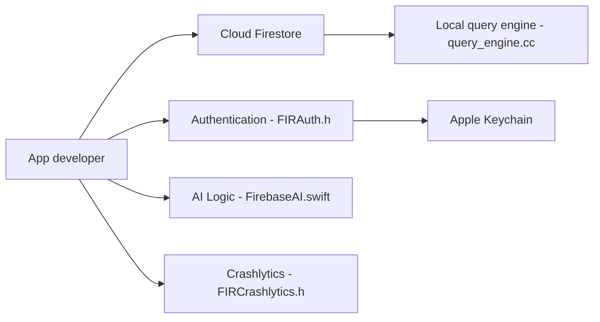

# firebase/firebase-ios-sdk

> Firebase SDK for Apple platforms, aimed at iOS app developers.

## The problem
Plug authentication, database, storage and crash reporting into an Apple app without writing the clients by hand.

## What it actually does
Collection of client libraries (excluding Analytics): Auth, Firestore, Realtime Database, Storage, Cloud Messaging, Remote Config, Crashlytics, App Check, AI Logic, etc. Installation via Swift Package Manager; CocoaPods will no longer receive new versions after October 2026. Firestore has a local query engine (indexes, cache keys, full scan).

## How it is wired


## Trying it
```bash
pod 'FirebaseCore', :git => 'https://github.com/firebase/firebase-ios-sdk.git', :branch => 'main'
pod 'FirebaseFirestore', :git => 'https://github.com/firebase/firebase-ios-sdk.git', :branch => 'main'
```

## Cost and gotchas
Firebase services require a Firebase project (outside the repository). watchOS and visionOS: partial or community support.

## What it is not
Not a backend: only the clients. Combine is still "not production ready".

## Alternatives
No alternative named in the README.

## For you
Ignore: Apple mobile SDK tied to a SaaS, with no direct relation to data/AI/MLOps (except Firebase AI Logic).
