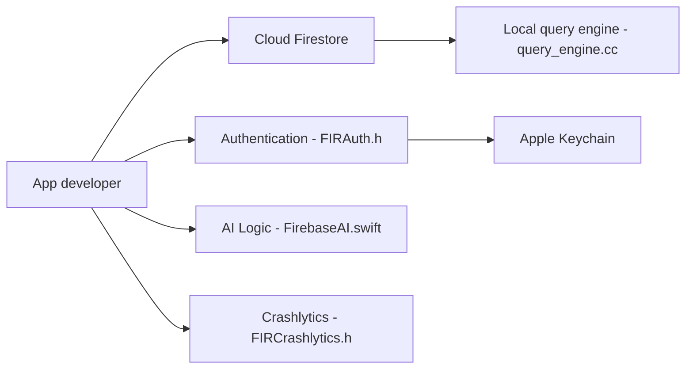

# firebase/firebase-ios-sdk

> SDK Firebase pour plateformes Apple, destiné aux développeurs d'applications iOS.

## Le problème
Brancher authentification, base de données, stockage et crash reporting à une app Apple sans écrire les clients à la main.

## Ce que ça fait vraiment
Collection de bibliothèques clientes (hors Analytics) : Auth, Firestore, Realtime Database, Storage, Cloud Messaging, Remote Config, Crashlytics, App Check, AI Logic, etc. Installation par Swift Package Manager ; CocoaPods ne recevra plus de nouvelles versions après octobre 2026. Firestore a un moteur de requête local (index, clés en cache, balayage complet).

## Comment c'est branché


## Essayer
```bash
pod 'FirebaseCore', :git => 'https://github.com/firebase/firebase-ios-sdk.git', :branch => 'main'
pod 'FirebaseFirestore', :git => 'https://github.com/firebase/firebase-ios-sdk.git', :branch => 'main'
```

## Coût et pièges
Les services Firebase nécessitent un projet Firebase (hors dépôt). watchOS et visionOS : support partiel ou communautaire.

## Ce que ce n'est pas
Pas un backend : seulement les clients. Combine reste « non prêt pour la production ».

## Alternatives
Aucune alternative nommée dans le README.

## Pour toi
À ignorer : SDK mobile Apple lié à un SaaS, sans rapport direct avec data/IA/MLOps (sauf Firebase AI Logic).

