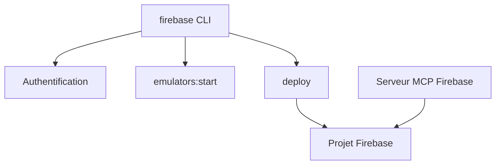

# firebase/firebase-tools

> Official Firebase command line and MCP server, for testing and deploying projects.

## The problem
Deploying and managing a Firebase project (hosting, functions, databases) from a terminal or an AI agent requires an official tool.

## What it actually does
The `firebase` command deploys code and resources, runs local emulators, manages Firestore, the realtime database, authentication, functions and their secrets, App Distribution and Remote Config. The repository also hosts the Firebase MCP server. It can be used as a Node module and in CI through a service account.

## How it is wired
Simplified diagram based on the sheet, no diagram provided.



## Trying it
```bash
npm install -g firebase-tools
curl -sL firebase.tools | bash
firebase login
firebase --project="foo" apps:list ANDROID
```

## Cost and gotchas
The tool is free but it acts on a Google/Firebase account whose services may be billed. The `login:ci` token is deprecated: prefer a service account. 1,084 open issues.

## What it is not
Not an independent tool: it only serves the Firebase ecosystem. Commands that require a local file system do not work in Cloud Functions.

## Alternatives
No alternative named in the README.

## For you
Worth watching: keep it only if your apps or AI prototypes live on Firebase, and especially the MCP server if you drive Firebase from an agent.
