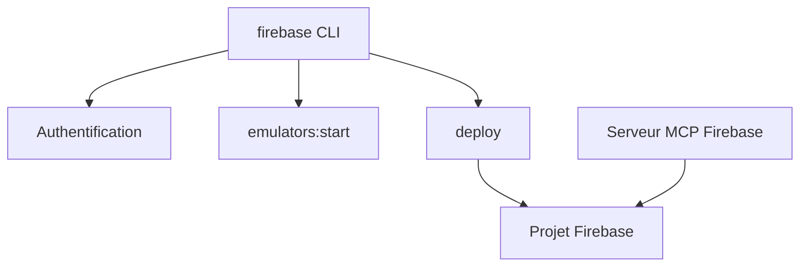

# firebase/firebase-tools

> Ligne de commande et serveur MCP officiels de Firebase, pour tester et déployer des projets.

## Le problème
Déployer et gérer un projet Firebase (hébergement, fonctions, bases) depuis un terminal ou un agent IA demande un outil officiel.

## Ce que ça fait vraiment
La commande `firebase` déploie code et ressources, lance des émulateurs locaux, gère Firestore, la base temps réel, l'authentification, les fonctions et leurs secrets, App Distribution et Remote Config. Le dépôt héberge aussi le serveur MCP Firebase. Elle s'utilise comme module Node et en CI via un compte de service.

## Comment c'est branché
Schéma simplifié d'après la fiche, sans diagramme fourni.



## Essayer
```bash
npm install -g firebase-tools
curl -sL firebase.tools | bash
firebase login
firebase --project="foo" apps:list ANDROID
```

## Coût et pièges
L'outil est gratuit mais il agit sur un compte Google/Firebase dont les services peuvent être facturés. Le jeton `login:ci` est déprécié : préfère un compte de service. 1 084 issues ouvertes.

## Ce que ce n'est pas
Pas un outil indépendant : il ne sert qu'à l'écosystème Firebase. Les commandes qui exigent un système de fichiers local ne marchent pas dans Cloud Functions.

## Alternatives
Aucune alternative nommée dans le README.

## Pour toi
À surveiller : à retenir seulement si tes applis ou prototypes IA vivent sur Firebase, et surtout le serveur MCP si tu pilotes Firebase depuis un agent.

