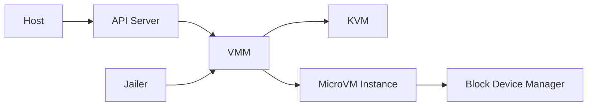

# firecracker-microvm/firecracker

> Minimal KVM virtual machine monitor for isolating multi-tenant workloads (containers, functions).

## The problem
Isolating untrusted workloads with the security of a VM but the fast startup of a container.

## What it actually does
A single VMM process that exposes a REST API (specified in OpenAPI) to configure vCPUs, memory, disks, network interfaces, vsock, rate limiters, logging and metrics, then start the microVM. Per-thread seccomp filters and a "jailer" (cgroups, namespaces, privilege dropping). Born at AWS for Lambda and Fargate.

## How it is wired


## Trying it
```bash
git clone https://github.com/firecracker-microvm/firecracker
cd firecracker
tools/devtool build
toolchain="$(uname -m)-unknown-linux-musl"
```

## Cost and gotchas
Free, but requires KVM on the host (the README mostly tests AWS metal instances) and careful Linux host configuration for multi-tenancy. Docker required to build.

## What it is not
Not a container runtime nor an orchestrator: it is a building block, integrated into Kata Containers and Flintlock. Documented limitation: pl031 RTC clock without interrupts on aarch64.

## Alternatives
Kata Containers and Flintlock: integrations that use Firecracker rather than substitutes.

## For you
Keep an eye on it: relevant if you build a platform that runs untrusted code (agent sandboxes, notebooks), of little use otherwise.
