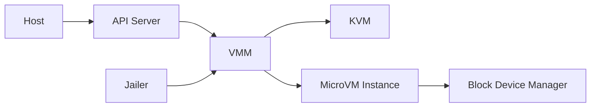

# firecracker-microvm/firecracker

> Moniteur de machines virtuelles KVM minimal pour isoler des charges multi-locataires (conteneurs, fonctions).

## Le problème
Isoler des charges de travail non fiables avec la sécurité d'une VM mais le démarrage rapide d'un conteneur.

## Ce que ça fait vraiment
Un processus VMM unique qui expose une API REST (spécifiée en OpenAPI) pour configurer vCPU, mémoire, disques, interfaces réseau, vsock, limiteurs de débit, journalisation et métriques, puis démarrer la microVM. Filtres seccomp par thread et un « jailer » (cgroups, namespaces, baisse de privilèges). Né chez AWS pour Lambda et Fargate.

## Comment c'est branché


## Essayer
```bash
git clone https://github.com/firecracker-microvm/firecracker
cd firecracker
tools/devtool build
toolchain="$(uname -m)-unknown-linux-musl"
```

## Coût et pièges
Gratuit, mais exige KVM sur l'hôte (le README teste surtout des instances AWS metal) et une configuration d'hôte Linux soignée pour la multi-location. Docker requis pour compiler.

## Ce que ce n'est pas
Pas un runtime de conteneurs ni un orchestrateur : c'est une brique, intégrée à Kata Containers et Flintlock. Limite documentée : horloge RTC pl031 sans interruptions sur aarch64.

## Alternatives
Kata Containers et Flintlock : des intégrations qui utilisent Firecracker plutôt que des substituts.

## Pour toi
À surveiller : pertinent si tu construis une plateforme qui exécute du code non fiable (bacs à sable d'agents, notebooks), peu utile sinon.

