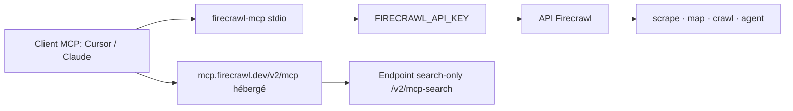

# firecrawl/firecrawl-mcp-server

> MCP server that gives an agent web search, scraping and page interaction.

## The problem
An agent that needs to read the web runs into raw HTML, retries, rate limits, and pages that only show their content after a click.

## What it actually does
Exposes up to 25 MCP tools, with clearly separated roles: `scrape` for a known URL, `map` to discover a site's URLs without loading them, `crawl` for several pages bounded by `limit` and `maxDiscoveryDepth`, `search` to start from a query, `interact` to click, type and navigate, `parse` for files, `agent` for structured multi-source research, and `monitor_*` to watch a page with diffs. The schema-based JSON format is recommended over markdown, so as not to saturate the context window.

## How it is wired


## Trying it
```bash
env FIRECRAWL_API_KEY=fc-YOUR_API_KEY npx -y firecrawl-mcp
npm install -g firecrawl-mcp
env HTTP_STREAMABLE_SERVER=true FIRECRAWL_API_KEY=fc-YOUR_API_KEY npx -y firecrawl-mcp
export FIRECRAWL_API_URL=https://firecrawl.your-domain.com
```

## Cost and gotchas
The free tier without a key only gives `scrape`, `search` and `parse`, with rate limiting; `crawl`, `map` and `agent` require a paid key. A search costs 2 credits, 1 of which is refunded for feedback, capped at 100 credits per team per UTC day. The README warns that an unbounded `crawl` overflows the context window. Never put the key in the URL or in an agent chat.

## What it is not
It is not step-by-step browser control: each `interact` runs a full turn and hands control back. It is not free at scale. The feedback tools send data back to Firecrawl, unless `FIRECRAWL_NO_SEARCH_FEEDBACK=1` is set.

## Alternatives
No alternative named in the README.

## For you
The fastest way to give the web to an agent — watch your credit consumption.
