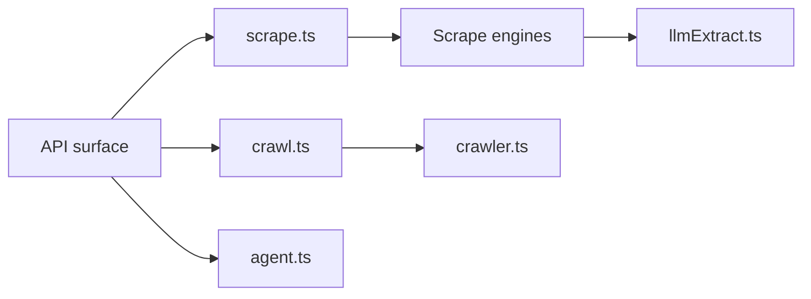

# firecrawl/firecrawl

> API that searches, extracts, and interacts with the web, providing clean output for agents and RAG (Retrieval-Augmented Generation) systems.

## The problem
Feeding a large language model (LLM) with web pages requires managing JavaScript, proxies, rate limits, and HTML cleaning.

## What it actually does
The following functionalities are available: search, scraping, crawling, mapping, batch scraping, document parsing (PDF, DOCX), interaction (clicking, scrolling based on prompts), and an agent (describing the need without URLs). Output formats include Markdown, structured JSON, or capture. The SDK is available for Python, Node, Go, Java, Elixir, Rust, Ruby, .NET, PHP, as well as a command-line interface (CLI), skills, and an MCP server. The agent mode runs on the spark-2 model.

## How it is wired


## Trying it
```bash
pip install firecrawl
npm install firecrawl
npx -y firecrawl-cli@latest init --all --browser
firecrawl scrape https://firecrawl.dev
```

## Cost and gotchas
API key to create on firecrawl.dev; the credit is consumed per page. Self-hosting is possible, but the cloud version has additional features (list available in the README). AGPL-3.0.

## What it is not
Not just a local scraper: the key lies in the hosted API. The coverage and latency figures are those provided by the publisher, and have not been verified here.

## Alternatives
In the README, Apify and ScrapingBee are mentioned as alternatives to the agent.

## For you
This is suitable for feeding a RAG pipeline or agent with clean pages, while keeping the AGPL license in mind if you are self-hosting it.
