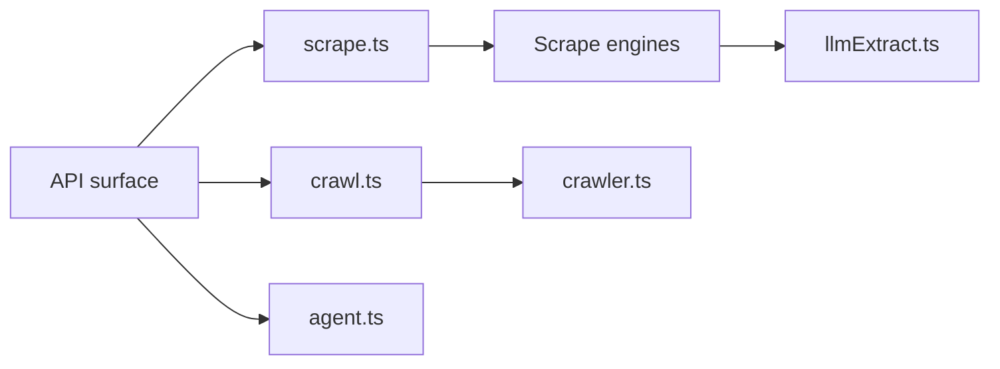

# firecrawl/firecrawl

> API qui cherche, extrait et fait interagir avec le web, en sortie propre pour agents et RAG.

## Le problème
Alimenter un LLM avec des pages web demande de gérer JavaScript, proxys, limites de débit et nettoyage du HTML.

## Ce que ça fait vraiment
Points d'accès search, scrape, crawl, map, batch scrape, parse de documents (PDF, DOCX), interact (cliquer, scroller par prompt) et agent (décrire le besoin, sans URL). Sortie en markdown, JSON structuré ou capture. SDK Python, Node, Go, Java, Elixir, Rust, Ruby, .NET, PHP, plus CLI, skill et serveur MCP. Le mode agent tourne sur le modèle spark-2.

## Comment c'est branché


## Essayer
```bash
pip install firecrawl
npm install firecrawl
npx -y firecrawl-cli@latest init --all --browser
firecrawl scrape https://firecrawl.dev
```

## Coût et pièges
Clé d'API à créer sur firecrawl.dev ; le crédit est consommé par page. L'auto-hébergement est possible mais la version cloud a des fonctions en plus (liste coupée dans le README). AGPL-3.0.

## Ce que ce n'est pas
Pas un simple scraper local : l'essentiel passe par l'API hébergée. Les chiffres de couverture et de latence sont ceux de l'éditeur, non vérifiés ici.

## Alternatives
Dans le README, Apify et ScrapingBee sont cités comme comparaison pour l'agent.

## Pour toi
À adopter pour nourrir un pipeline RAG ou un agent en pages propres, en gardant l'AGPL en tête si tu l'auto-héberges.

