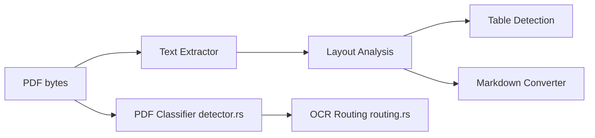

# firecrawl/pdf-inspector

> Rust library that classifies a PDF (text or scan) and converts it to Markdown without OCR.

## The problem
Sending every PDF to an OCR service costs time and money, while a good share of them already contain text.

## What it actually does
Detects in a few tens of ms whether the PDF is text, scanned, image or mixed, then extracts the text with positions, columns, tables and headings into Markdown. Selective OCR (PP-OCRv6, external PDFium and ONNX Runtime) only processes the pages that need it. Python, Node, WebAssembly and CLI bindings. On 200 PDFs, overall score 0.875 in 0.47 s (vendor benchmark).

## How it is wired


## Trying it
```bash
pip install pdf-inspector
pdf2md document.pdf
pdf2md document.pdf --json
detect-pdf document.pdf --analyze --json
```

## Cost and gotchas
Free. OCR requires PDFium and ONNX Runtime installed separately; without them, only text pages are processed.

## What it is not
Not an OCR by default: scans go through the optional OCR path. The benchmark comes from the vendor, on a corpus of native PDFs, with OCR disabled.

## Alternatives
liteparse, opendataloader, pymupdf4llm and markitdown (compared in the README benchmark).

## For you
Adopt: a local, fast, MIT-licensed PDF preprocessing step to feed a RAG pipeline, with OCR fallback only when necessary.
