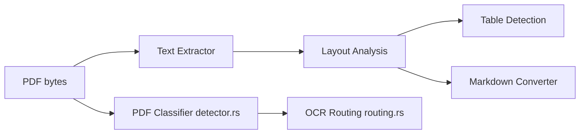

# firecrawl/pdf-inspector

> Bibliothèque Rust qui classe un PDF (texte ou scan) et le convertit en Markdown sans OCR.

## Le problème
Envoyer chaque PDF à un service d'OCR coûte du temps et de l'argent, alors qu'une bonne part contient déjà du texte.

## Ce que ça fait vraiment
Détecte en quelques dizaines de ms si le PDF est texte, scanné, image ou mixte, puis extrait le texte avec positions, colonnes, tableaux et titres vers du Markdown. Un OCR sélectif (PP-OCRv6, PDFium et ONNX Runtime externes) ne traite que les pages qui en ont besoin. Liaisons Python, Node, WebAssembly et CLI. Sur 200 PDF, score global 0,875 en 0,47 s (benchmark de l'éditeur).

## Comment c'est branché


## Essayer
```bash
pip install pdf-inspector
pdf2md document.pdf
pdf2md document.pdf --json
detect-pdf document.pdf --analyze --json
```

## Coût et pièges
Gratuit. L'OCR demande PDFium et ONNX Runtime installés à part ; sans eux, seules les pages texte sont traitées.

## Ce que ce n'est pas
Pas un OCR par défaut : les scans passent par le chemin OCR optionnel. Le benchmark vient de l'éditeur, sur un corpus de PDF natifs, OCR désactivé.

## Alternatives
liteparse, opendataloader, pymupdf4llm et markitdown (comparés dans le benchmark du README).

## Pour toi
À adopter : un prétraitement PDF local, rapide et sous MIT pour alimenter un pipeline RAG, avec repli OCR seulement quand nécessaire.

