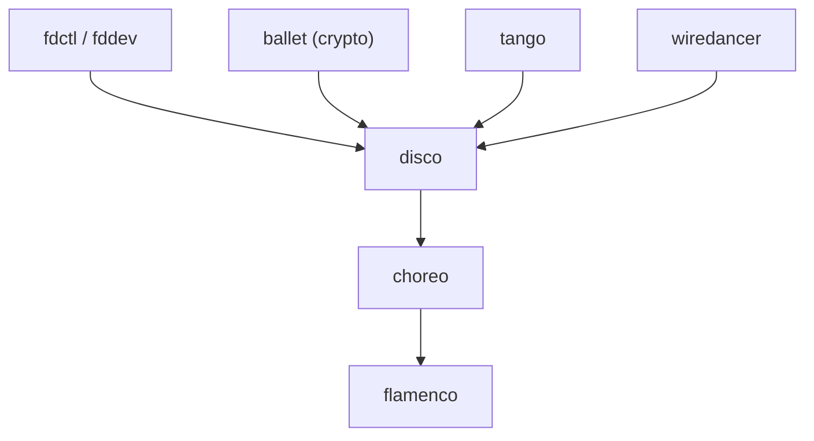

# firedancer-io/firedancer

> Solana validator client written from scratch in C, for node operators.

## The problem
The Solana network depended on a dominant validator client, hence a risk of software monoculture and performance limits.

## What it actually does
Solana validator designed for low latency, with a very restrictive sandbox and almost no system calls. The code is split into modules (ballet for crypto, tango, disco, flamenco, choreo) and includes FPGA paths (wiredancer). It exists in two variants, Frankendancer (hybrid) and Firedancer.

## How it is wired


## Trying it
```bash
git clone https://github.com/firedancer-io/firedancer.git
cd firedancer
./deps.sh
make -j
./build/firedancer-dev --testnet
```

## Cost and gotchas
Linux only, kernel 4.18 or later. The dev command changes the system configuration via sudo. License present but not identified: read it before any use.

## What it is not
Not a tool for developing on Solana: it is the infrastructure that validates blocks. The README points to the official documentation for operation.

## Alternatives
No alternative named in the README.

## For you
Ignore: blockchain infrastructure software, no link with a data or ML pipeline; interesting only as a read of highly optimized C code.
