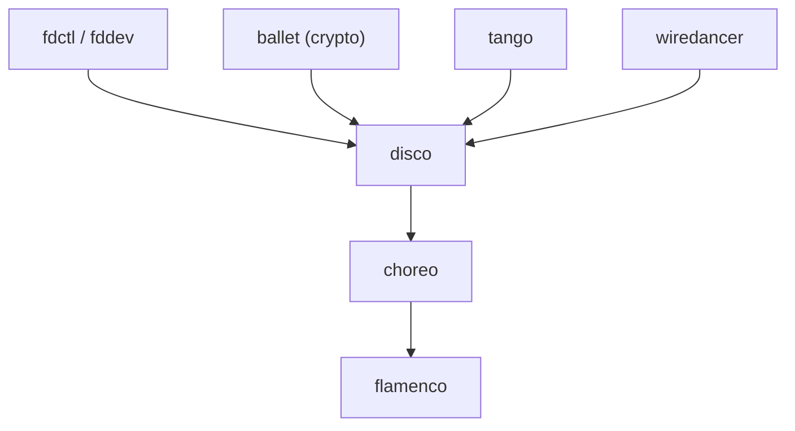

# firedancer-io/firedancer

> Client validateur Solana écrit de zéro en C, pour les opérateurs de nœuds.

## Le problème
Le réseau Solana dépendait d'un client validateur dominant, d'où un risque de monoculture logicielle et des limites de performance.

## Ce que ça fait vraiment
Validateur Solana conçu pour la faible latence, avec un sandbox très restrictif et presque sans appels système. Le code est découpé en modules (ballet pour la crypto, tango, disco, flamenco, choreo) et inclut des chemins pour FPGA (wiredancer). Il existe en deux variantes, Frankendancer (hybride) et Firedancer.

## Comment c'est branché


## Essayer
```bash
git clone https://github.com/firedancer-io/firedancer.git
cd firedancer
./deps.sh
make -j
./build/firedancer-dev --testnet
```

## Coût et pièges
Linux uniquement, noyau 4.18 ou plus. La commande de dev modifie la configuration système via sudo. Licence présente mais non identifiée : à lire avant tout usage.

## Ce que ce n'est pas
Pas un outil pour développer sur Solana : c'est l'infrastructure qui valide les blocs. Le README envoie vers la documentation officielle pour l'exploitation.

## Alternatives
Aucune alternative nommée dans le README.

## Pour toi
Ignorer : logiciel d'infrastructure blockchain, aucun lien avec un pipeline data ou ML ; intéressant seulement comme lecture d'un code C très optimisé.

