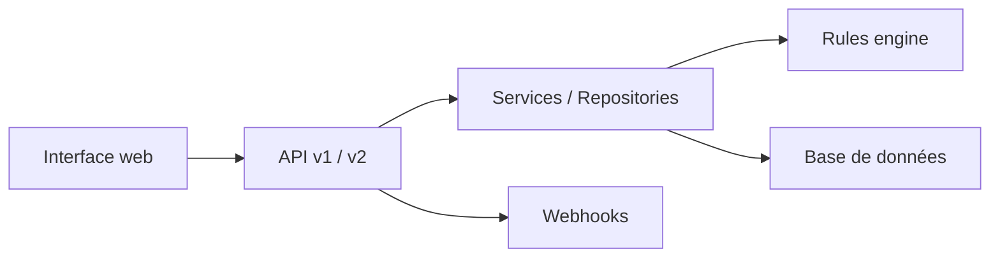

# firefly-iii/firefly-iii

> Self-hosted personal finance manager, with no AI and no cloud.

## The problem
Knowing where your money goes without handing your statements to a cloud service.

## What it actually does
Tracks expenses and income with budgets, categories, tags, double-entry bookkeeping, recurring transactions, custom rules, piggy banks, reports, multi-currency, two-factor authentication, and a JSON REST API. It does not contact any external server unless explicitly asked. Docker image and Kubernetes deployment available.

## How it is wired

## Trying it
No command documented in the README; installation is described in the project documentation.

## Cost and gotchas
Free when self-hosted; paid hosts are offered (Hostinger, PikaPods). You need to be comfortable with server administration.

## What it is not
Not a bank aggregator: import goes through separate tools (the data importer).

## Alternatives
No alternative named in the README.

## For you
Personal use, unrelated to your field; ignore for watch purposes, with AGPL on top if you host it for third parties.
