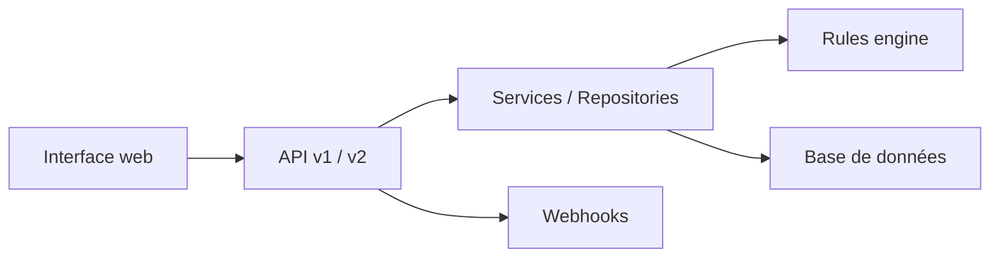

# firefly-iii/firefly-iii

> Gestionnaire de finances personnelles auto-hébergé, sans IA ni cloud.

## Le problème
Savoir où va son argent sans confier ses relevés à un service cloud.

## Ce que ça fait vraiment
Suit dépenses et revenus avec budgets, catégories, tags, comptabilité en partie double, transactions récurrentes, règles personnalisées, tirelires, rapports, multi-devises, authentification à deux facteurs, API REST JSON. Il ne contacte pas de serveur externe sauf demande explicite. Image Docker et déploiement Kubernetes disponibles.

## Comment c'est branché

## Essayer
Aucune commande documentée dans le README ; l'installation est décrite dans la documentation du projet.

## Coût et pièges
Gratuit en auto-hébergement ; hébergeurs payants proposés (Hostinger, PikaPods). Il faut être à l'aise avec l'administration de serveurs.

## Ce que ce n'est pas
Pas un agrégateur bancaire : l'import passe par des outils séparés (importeur de données).

## Alternatives
Aucune alternative nommée dans le README.

## Pour toi
Usage personnel, étranger à ton métier ; à ignorer côté veille, AGPL en prime si tu l'héberges pour des tiers.

