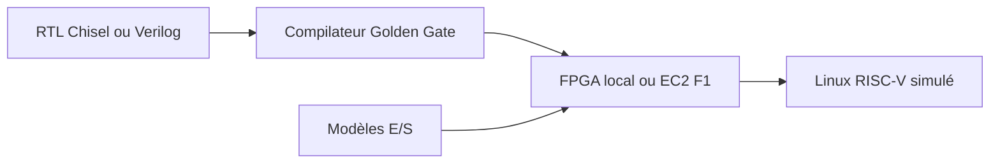

# firesim/firesim

> FPGA-accelerated hardware simulation platform, for chip designers and computer architecture researchers.

## The problem
Simulating a processor or an SoC in RTL with software is too slow to run real workloads.

## What it actually does
- Simulates designs written in Chisel or Verilog at 10 to 100 MHz.
- Runs on local FPGAs (Xilinx Alveo) or in the cloud (Amazon EC2 F1), up to hundreds of FPGAs.
- Provides I/O models (DRAM, Ethernet, disks, UART) and cycle-accurate network simulation.
- Ships a Linux distribution compatible with the simulated RISC-V systems.
- Origin: UC Berkeley.

## How it is wired

## Trying it
No command documented in the README (it points to docs.fires.im).

## Cost and gotchas
FPGA hardware or paid cloud instances. A license is present but not identified by GitHub.

## What it is not
Not a simple software simulator. You need a hardware design and an FPGA budget.

## Alternatives
Chipyard, Rocket Chip and BOOM (cited as sources of RTL designs, not as replacements).

## For you
Ignore: chip design, outside the data / AI / MLOps scope.
