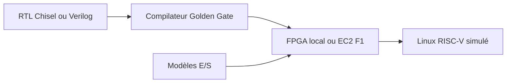

# firesim/firesim

> Plateforme de simulation matérielle accélérée par FPGA, pour concepteurs de puces et chercheurs en architecture.

## Le problème
Simuler un processeur ou un SoC en RTL avec des logiciels est trop lent pour faire tourner des charges réelles.

## Ce que ça fait vraiment
- Simule des designs écrits en Chisel ou Verilog à 10 à 100 MHz.
- Tourne sur FPGA locaux (Xilinx Alveo) ou dans le cloud (Amazon EC2 F1), jusqu'à des centaines de FPGA.
- Fournit des modèles d'E/S (DRAM, Ethernet, disques, UART) et une simulation réseau précise au cycle près.
- Livre une distribution Linux compatible avec les systèmes RISC-V simulés.
- Origine : UC Berkeley.

## Comment c'est branché

## Essayer
Aucune commande documentée dans le README (renvoi à docs.fires.im).

## Coût et pièges
Matériel FPGA ou instances cloud payantes. Licence présente mais non identifiée par GitHub.

## Ce que ce n'est pas
Pas un simulateur logiciel simple. Il faut une conception matérielle et un budget FPGA.

## Alternatives
Chipyard, Rocket Chip et BOOM (cités comme sources de designs RTL, pas comme remplaçants).

## Pour toi
À ignorer : conception de puces, hors périmètre data / IA / MLOps.

