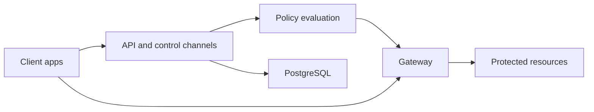

# firezone/firezone

> Zero-trust remote access platform built on WireGuard, with identity-based policies and audit logs.

## The problem
Give specific people conditional access to private applications, databases or subnets, without a wide-open VPN.

## What it actually does
An Elixir/Phoenix control plane (accounts, groups, resources, policies, PostgreSQL) and a Rust data plane (gateway, STUN/TURN relays, WireGuard tunnels). Clients for Windows, macOS, Linux, iOS, Android, headless. Integrations with Google, Okta, Entra, OIDC; logs can be exported to a SIEM.

## How it is wired

## Trying it
No documented command: the README recommends signing up for the cloud and the Quickstart; self-hosting goes through CONTRIBUTING.md.

## Cost and gotchas
Cloud offering with plans (freemium, see pricing). Self-hosting in production is not officially supported; published clients are only guaranteed with the managed service.

## What it is not
Not a turnkey self-hostable VPN. The advertised throughput (up to 10 Gbit/s and more) is the vendor's own, not verified here.

## Alternatives
No alternative named in the README.

## For you
Keep an eye on it: relevant for giving access to private GPUs or databases, but self-hosting is not supported.
