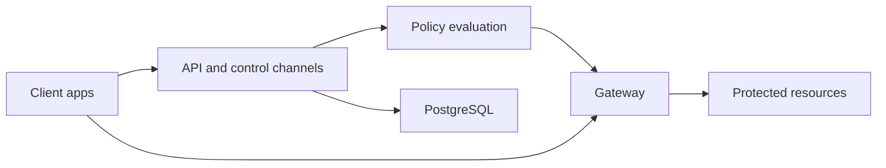

# firezone/firezone

> Plateforme d'accès distant zero-trust sur WireGuard, avec politiques par identité et journaux d'audit.

## Le problème
Donner accès à des applications, bases ou sous-réseaux privés à des personnes précises, sous conditions, sans VPN grand ouvert.

## Ce que ça fait vraiment
Un plan de contrôle Elixir/Phoenix (comptes, groupes, ressources, politiques, PostgreSQL) et un plan de données en Rust (passerelle, relais STUN/TURN, tunnels WireGuard). Clients Windows, macOS, Linux, iOS, Android, headless. Intégrations Google, Okta, Entra, OIDC ; journaux exportables vers un SIEM.

## Comment c'est branché

## Essayer
Aucune commande documentée : le README recommande l'inscription au cloud et le Quickstart ; l'auto-hébergement passe par CONTRIBUTING.md.

## Coût et pièges
Offre cloud avec plans (freemium, voir tarifs). L'auto-hébergement en production n'est pas officiellement supporté ; les clients publiés ne sont garantis qu'avec le service géré.

## Ce que ce n'est pas
Pas un VPN auto-hébergeable clé en main. Les débits annoncés (jusqu'à 10 Gbit/s et plus) sont ceux de l'éditeur, non vérifiés ici.

## Alternatives
Aucune alternative nommée dans le README.

## Pour toi
Surveiller : pertinent pour donner accès à des GPU ou bases privées, mais l'auto-hébergement n'est pas soutenu.

