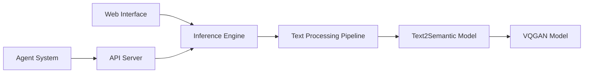

# fishaudio/fish-speech

> Multilingual speech synthesis with voice cloning and emotion control, open weights under a restrictive license.

## The problem
Open TTS models lack fine-grained expressiveness and fast cloning across many languages.

## What it actually does
S2-Pro model (4B parameters) Dual-AR: a slow AR for the semantic codebook, a fast AR (400M) for 9 residual codebooks.
Natural-language tags in the text (`[whisper]`, `[angry]`…), multi-speaker, multi-turn dialogues.
Voice cloning from 10 to 30 s of audio; 80+ languages.
Inference via CLI, WebUI, server, Docker; acceleration with SGLang or vLLM-Omni.

## How it is wired

## Trying it
No command documented in the README: installation points to the external documentation.

## Cost and gotchas
Substantial GPU (figures given on H200). "Fish Audio Research License" on the code and weights, with an explicit threat of legal action in case of violation.

## What it is not
Not open source in the OSI sense: commercial use is not guaranteed. The benchmarks are the vendor's own.

## Alternatives
- GPT-SoVITS: cited in the credits, another cloning TTS.
- Bert-VITS2: cited in the credits.

## For you
Quality worth watching, but read the license before any use beyond research.
