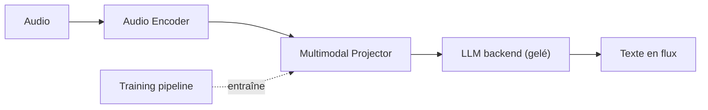

# fixie-ai/ultravox

> Multimodal LLM that understands speech directly, with no separate speech recognition step.

## The problem
Chaining ASR then an LLM adds latency and loses cues of tone and rhythm.

## What it actually does
A multimodal projector converts the output of an audio encoder into the space of an open LLM (Llama 3, Mistral, Gemma). The LLM and the encoder stay frozen: only the adapter is trained. The model takes audio as input and emits streamed text; speech generation is planned for later. The repository contains training, evaluation and configs.

## How it is wired


## Trying it
```bash
just install
poetry run python -m ultravox.training.train --config_path ultravox/training/configs/example_config.yaml
just eval --config_path ultravox/evaluation/configs/eval_config.yaml
```

## Cost and gotchas
The default model is based on Llama 3.3 70B (8B variant on Hugging Face). Training described on 8 H100s. The training tooling relied on MosaicML, a platform that closed in late July 2025.

## What it is not
Does not generate speech (text output only). The real-time API is a managed service from the vendor.

## Alternatives
No alternative named in the README.

## For you
To watch: interesting approach for low-latency voice agents, but the 70B needs a lot of GPU and the most useful version goes through the vendor's paid offering.
