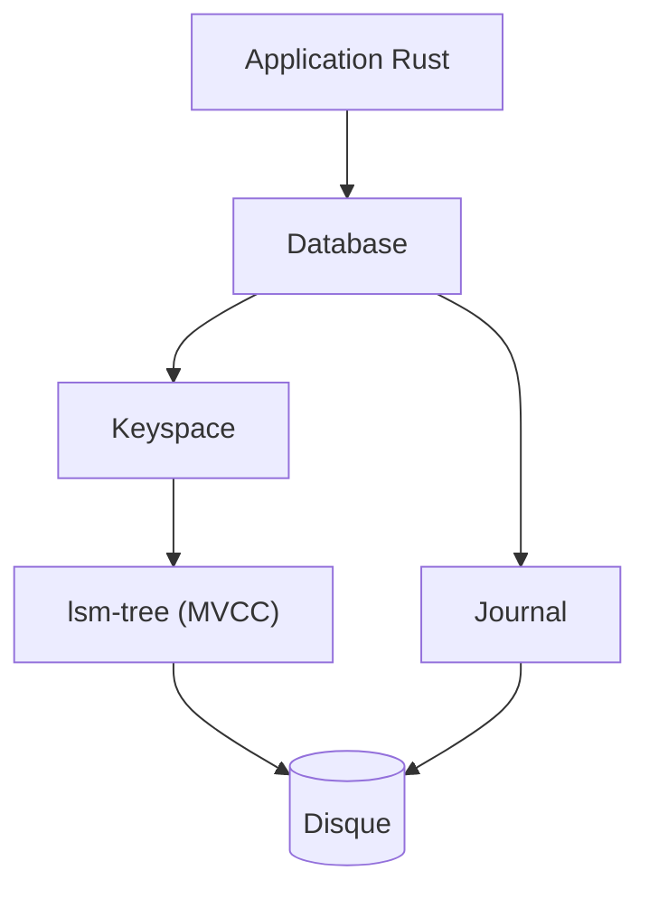

# fjall-rs/fjall

> Embedded key-value storage engine in Rust, based on an LSM tree, for Rust developers.

## The problem
You need to store lots of key-value data on disk in a Rust application, without running a server or linking C++ like RocksDB.

## What it actually does
A 100% safe Rust library exposing an API close to a BTreeMap: insert, read, delete, range or prefix search, in both directions. Several isolated "keyspaces" (column families), LZ4 compression by default, optional serializable transactions, key-value separation for large blobs. Background maintenance is automatic.

## How it is wired
Simplified diagram based on the fiche, no diagram provided.



## Trying it
```bash
cargo add fjall
```
Then, in code: `Database::builder(path).open()?`, `db.keyspace("my_items", KeyspaceCreateOptions::default)?`, `items.insert("a", "hello")?`.

## Cost and gotchas
Free, nothing to create. By default writes go to system buffers, not to disk: call `db.persist(PersistMode::SyncAll)` for durability. The same folder cannot be opened by several processes.

## What it is not
Neither a database server nor a relational database: no columns and no query language. Keys are sorted in lexicographic order, so integers need big endian encoding.

## Alternatives
- RocksDB: cited as the model for the LSM approach, with the same default durability level.

## For you
Watch: useful if you write Rust with a local storage need, but outside your daily data / AI work unless you are building an engine in Rust.
