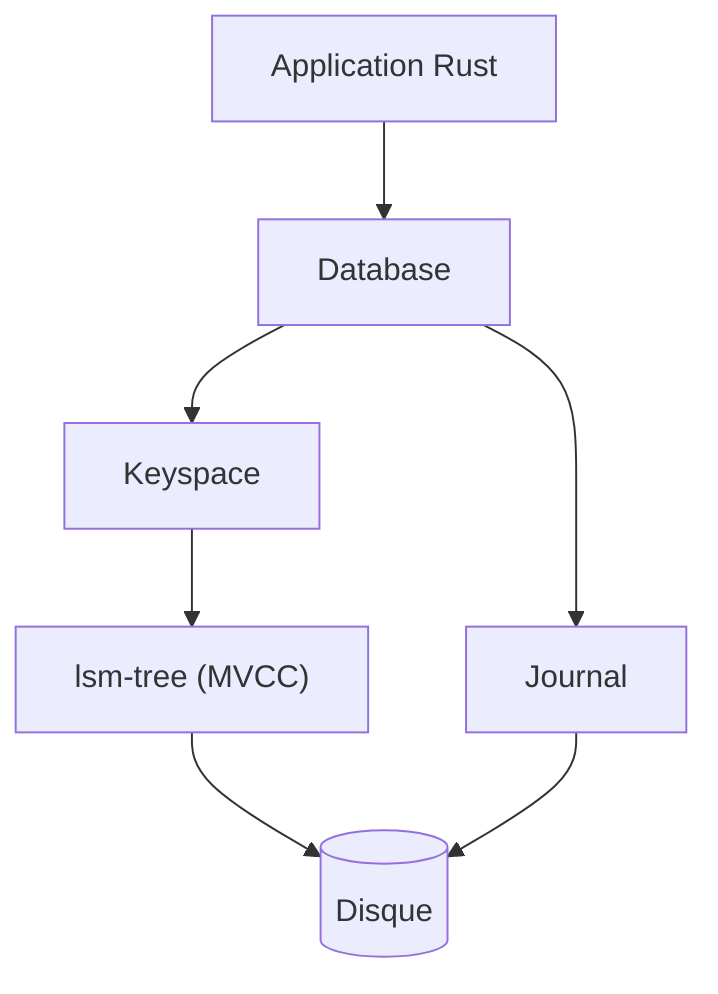

# fjall-rs/fjall

> Moteur de stockage clé-valeur embarqué en Rust, à base d'arbre LSM, pour développeurs Rust.

## Le problème
Il faut stocker beaucoup de données clé-valeur sur disque dans une application Rust, sans lancer de serveur ni lier du C++ comme RocksDB.

## Ce que ça fait vraiment
Une bibliothèque Rust 100 % sûre qui expose une API proche d'une BTreeMap : insertion, lecture, suppression, recherche par plage ou préfixe, dans les deux sens. Plusieurs « keyspaces » (familles de colonnes) isolés, compression LZ4 par défaut, transactions sérialisables en option, séparation clé-valeur pour les gros blobs. La maintenance de fond est automatique.

## Comment c'est branché
Schéma simplifié d'après la fiche, sans diagramme fourni.



## Essayer
```bash
cargo add fjall
```
Puis, dans le code : `Database::builder(path).open()?`, `db.keyspace("my_items", KeyspaceCreateOptions::default)?`, `items.insert("a", "hello")?`.

## Coût et pièges
Gratuit, rien à créer. Par défaut l'écriture part dans les tampons du système, pas sur disque : appeler `db.persist(PersistMode::SyncAll)` pour la durabilité. Un même dossier ne peut pas être ouvert par plusieurs processus.

## Ce que ce n'est pas
Ni un serveur de base de données, ni une base relationnelle : pas de colonnes ni de langage de requête. Les clés sont triées en ordre lexicographique, donc les entiers demandent l'encodage big endian.

## Alternatives
- RocksDB : cité comme modèle de l'approche LSM, avec le même niveau de durabilité par défaut.

## Pour toi
À surveiller : utile si tu écris du Rust avec un besoin de stockage local, mais hors de ton quotidien data / IA tant que tu ne construis pas de moteur en Rust.

